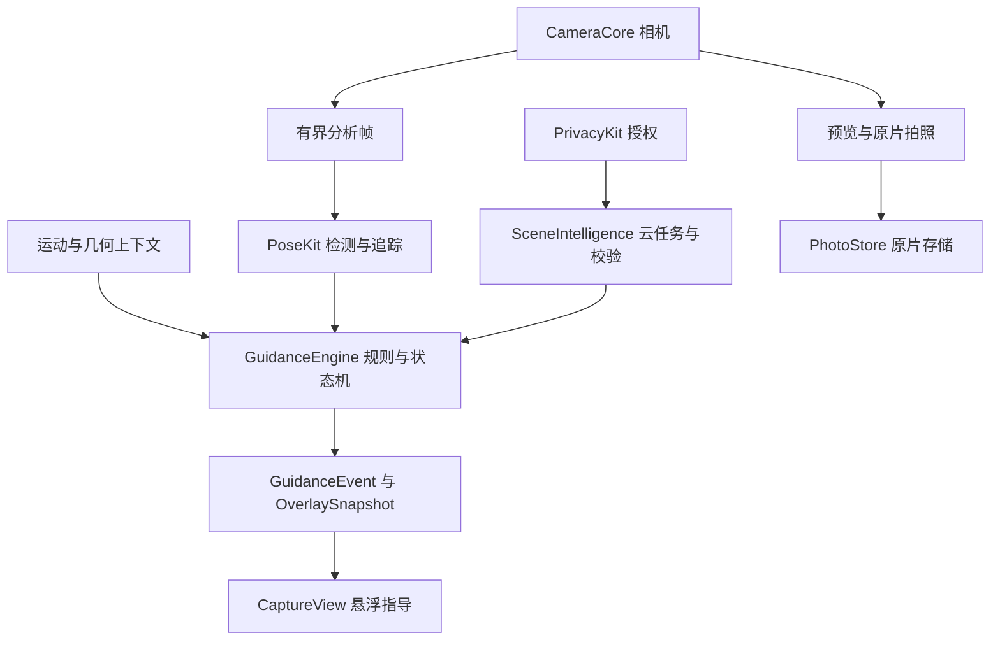
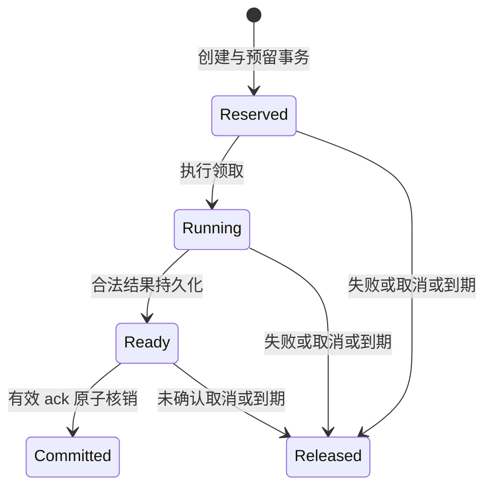

# AI 构图实现技术设计 · 基于 ppb-camera

版本：1.0｜日期：2026-11-02｜性质：增量设计，未实现声明。

基线：ppb-camera main@b3b7dadf82829631056eb28b98b8980df510362c；现状证据与边界见[代码分析](../implementation/2026-11-02-ppb-camera代码分析.md)。对应[FS-14](../pr/FS-14-AI构图分析与实时引导.md)与[专项验收](../ac/AI构图专项验收.md)。

## 1. 决策与兼容

- 复用 Swift 6 / iOS 17 / SwiftUI / AVFoundation 工程、13 包边界、PhotoStore 和 AccountKit，不另建 App、存储或身份系统。
- 全屏 aspectFill，普通快门完整原片；ROI 只做临时分析输入。本文不恢复旧 WYSIWYG 3:4 自动裁切。
- L1 为本地辅助/ROI，L2 为真实端侧检测，L3 为主动云增强。实际 L1 读取会本机拍照，不能再统称“零采集”。
- 端侧连续检测；云端单帧目标；模型不逐帧控制快门、曝光、变焦或移动手机。
- 继承逻辑接口 `/v1/analysis` 与 ready→ack→committed；真实外部网关路径和字段须核对 ppb-base IDL/路由后确定，不冒充已经接通。
- 后台复用 Vue 3 / Element Plus / base-manage-web。服务端 Go + MySQL/GORM 是当前文档口径，本轮未读取 ppb-base 验证；旧 React/Postgres 文字不是本轮新建栈的依据。

## 2. 模块与工程接线



| 现有落点 | 新增/复用 | 依赖约束 |
| --- | --- | --- |
| CameraCore/AVCameraSource | 新增视频分析输出、采样与几何元数据；复用 sessionQueue/生命周期 | 不导入 GuidanceEngine/SceneIntelligence/账号/权益 |
| CameraCore/CaptureSource | 保持拍照接口；新增独立 AnalysisFrameSource 能力协议 | 不让合成源和基础拍摄必须实现云能力 |
| PoseKit | 实现 Vision 关键点/人体框、主体关联、置信度 | 原始缓冲不进 SwiftUI，不直接发云请求 |
| GuidanceEngine | 纯值规则、单调时钟、滞回、优先级、就绪 | 不引用 UIKit、AVCaptureSession、支付或网络 |
| SceneIntelligence | 本地/云目标编排、上下文校验、ack/cancel | 无权取消已拍照片的持久化 |
| PrivacyKit | 分用途授权、版本、撤销、上传守卫 | 复用 UploadConsent 值模型，模型存在不等于守卫实现 |
| NetworkKit | 复用注入传输模式；新增分析任务传输，模板客户端保留 | 模板 GET 的重试策略不能直接套用可能计费的 POST |
| EntitlementKit | 只读权益、订单与任务对账 | 服务端为事实源，不在本地改余额 |
| SharedModels | AnalysisContext、RuleMeasurement、候选目标与事件 | 先定义清楚坐标域和 Sendable 边界 |
| AppEnvironment/工程配置 | 装配新包、启动/停用、identity epoch | 同步 project.yml 与生成工程，不能只创建 Package 文件 |
| Features/Capture | 拆分 ROI/变焦/提示组件；保留现有功能 | 页面只渲染状态，不复制规则判断 |

CaptureView 当前把几何、裁切、ROI 与变焦控件集中在大文件中。建议先提取可测试逻辑再接 L2，避免同时重写相机。GeometryMapper 可先作为 CameraCore 中无 UIKit 的纯几何类型，渲染与临时 UIImage 留 App；若依赖关系不合适再独立小包，不能提前泛化成平台框架。

## 3. 坐标、ROI 与照片范围

### 3.1 坐标域

| 域 | 约定 | 用途 |
| --- | --- | --- |
| D | 设备原始输出，含方向/镜像约定 | 采集和归一化 |
| I | upright 原片/分析图像像素 | 检测与像素裁切，须区分 image source |
| S | 预览层 bounds，pt | ROI 手势与控件位置 |
| R | ROI 在 I 或分析图中的明确区域 | 只限定分析输入，不改变照片保存 |
| O | 控件占据的屏幕矩形集合 | 提示避让，不参与照片是否出框判断 |

每个点/框都携带坐标域；采用左上原点向右/向下的统一中间约定，Vision 的实际输出原点、ROI 和预处理按具体 API 转换。不要默认人体框和 metadata 坐标可互换。

已有 AspectFillCropMapping 可作为初始实现，但不是所有视频/照片视野天然对齐的保证。对规范图像 W×H、预览 w×h，居中 aspectFill：

```text
s = max(w/W, h/H)
ox = (W*s-w)/2; oy = (H*s-h)/2
imageX = (screenX+ox)/s
imageY = (screenY+oy)/s
```

镜像、方向、输入补边/裁切、设备视野和稳定处理在公式之外，须保存正逆变换。`layerRectConverted(fromMetadataOutputRect:)` 要求正确 metadata 约定，不能直接喂 Vision 框。[S3]

### 3.2 保持 FS-12/13 的三种边界

1. 普通快门：直接保存完整 CapturedImage，不按照 ROI 或屏幕裁切。
2. ROI 读取：显式拍一张，方向归一并按当时 ROI 裁出内存预览；不写 PhotoStore、不上传。
3. L2 分析：视频帧与选定区域的检测输入，结果仅能证明该分析视野内的情况，不能推断看不到的原片外围。

若 ROI 裁掉脚，只说明无法评估脚部，不是照片裁脚。需要完整原片构图时，必须取得覆盖原片的分析源或明确展示可评估范围；没有校准证据先停用相关规则，不能把屏幕 normalized 值直接用于原片。

### 3.3 GeometrySnapshot 与失效

包含 input size/source、预览 bounds、orientation、镜像、camera/zoom、ROI normalized rect、正逆变换、geometryRevision、roiRevision。镜头/倍率/方向/布局/ROI 变化递增相应 revision。校准覆盖实际 photo/video 格式和设备配置；目前工程只竖屏，不因此宣称支持横屏。

相机旋转支持时参考 RotationCoordinator 的 preview/capture 两种角度；不要逐分析帧修改连接旋转引发重配置。[S5] 前摄镜像以实际连接配置为依据，当前假设必须真机验证。快门和 ROI 快照分别冻结当时几何，异步完成后不能读取新几何套到旧图片。

## 4. 分析帧与性能

新增 AVCaptureVideoDataOutput 时在 sessionQueue 配置，委托处理用独立队列；采集回调只取样与保留必要生命周期，快速返回。开启 alwaysDiscardsLateVideoFrames；应用层至多一个推理任务和一个最新待处理帧，不能创建无界 Task。[S7]

建议 FrameContext：frameID、sessionID、sceneRevision、geometryRevision、roiRevision、subjectTrackID、identityEpoch、模板版本、单调 timestamp。帧的内存类型按 Swift 6/SDK Sendable 约束设计，不能把所有 CVPixelBuffer 通过 unchecked Sendable 直接抛到任意 actor。

继承现有目标15fps/16ms；先用固定输入尺寸和支持机型实测，分别报告采集→排队→检测→规则→UI 时延。16ms 的计算段与100ms UI呈现段必须分别定义，不能混入1.5s触发驻留。多模型流水线可错频运行，但不把重绘帧率当检测帧率。

热降级沿用关轮廓→检测降10fps→仅参考线；具体恢复阈值用慢滞回。静态降级后清已达标状态。停止分析/切 Tab/后台时释放视觉与运动资源；恢复需重认当前主体和几何，不堆积旧帧。

现有 ROI 大图解码与裁切在 MainActor，未来移到专用图像执行上下文，回主线程只更新结果。优先通过 CGImage/ImageIO 或可安全跨隔离的数据完成方向归一，不能把 UIKit 线程问题用 unchecked 标记掩盖。迁移前后保留映射与裁切回归。

## 5. 检测、主体、规则与动作

### 5.1 检测证据

PoseKit 可采用 VNDetectHumanRectanglesRequest / VNDetectHumanBodyPoseRequest、人脸检测和 VNTrackObjectRequest 序列跟踪。[S1][S2] 先用固定序列确定精度和时延，不承诺“一定用 NPU”。周期重检纠偏；跟踪 ID 只表示连续轨迹，不是生物身份。

主体明显单人时选中，多人、遮挡交叉或重入不确定时让用户确认。不要每帧取最大框而静默换人。本轮首版不自动按多人外接框冒充单人构图，复杂合照另立需求。

框、关节、鞋底和头顶不是同一个几何对象。踝点不等于鞋底；衣物/遮挡导致点缺失不能判出框。输出 RuleMeasurement.value 可空，另含 confidence、visibility、coordinateSpace、reason。置信度不足0.6的关节不进入达标判定（继承既有规则），不同模型分数不能直接当同一概率。

### 5.2 规则状态

```text
RuleState = pass | fail | unknown | notApplicable
测量：人物框高/明确分析范围高度、中心点、头顶/脚部余量、倾斜、稳定性
就绪：必需且适用的规则全部可测、通过并满足驻留条件
```

FS-03 现有阈值作为起点，模板化记录版本。严重裁切风险不允许被其他规则高分抵消；不算一个模糊综合分遮住失败。跳过提示不等于规则 pass。

Core Motion 提供重力、角速度、姿态，辅助水平与稳定；设备坐标转到当前显示方向，极端俯仰下停用退化规则。[S6] 运动稳定不等于对焦准确、曝光合适或人物不动。显著性可描述关注区域，不直接证明背景杂乱或头部有路牌。

### 5.3 动作与指令

按已能验证的画面目标输出，例如“把人物放到左侧框内”“让人物在画面里小一点”。设备水平有传感器支持时才发旋转指令。单目框变化不能区分摄影者横移、转镜头和被拍者移动；不自动推导厘米、绝对高度或“向右半步”。

动作类型与 messageKey 固定枚举，文案在本地化表生成；云端不能下发执行脚本或直接控制变焦/曝光。目标达成后只宣称当前构图条件满足；表情、对焦、审美与拍摄时机另行评估。

## 6. GuidanceEngine 与双路输出

继承 idle→candidate→active→cleared/cooldown，candidate 持续1.5s，解除区持续1.0s，同类冷却2s，6s仍未解除升级一次。优先级无主体>出框>大小>倾斜>头顶>逆光>姿势。不通过本文静默改成另一套300ms参数。

时间注入使用单调时钟；平滑与滞回分开。unknown、掉帧、主体丢失不累计“持续通过”；上下文变化重置候选和历史。低置信度取消强指令并收起检测残影，系统不可用立即清就绪。

输出两路：

- GuidanceEvent：低频的文案/触觉/激活/解除，按 guidanceId 去重。
- OverlaySnapshot：有界最新几何/置信度，UI 可平滑但不能伪造有效测量；无新测量超过阈值时隐藏或降级。

CameraState、ROIState、GuidanceState、CloudTaskState 分开建模，不用一个 loading 控制快门。快门仅查询真实相机可用性与拍摄状态。现有 ROI 与普通拍照共用 PhotoOutput 的资源竞争需实测；以后 L2 不借连续 capturePhoto 模拟视频分析。

## 7. L3 云任务、结果结构与上下文

### 7.1 输入与输出

输入沿用：单帧 JPEG 长边≤1280、q目标0.7、purpose/template、手机姿态、requestId、consentVersion；新增有版本的 clientContext（会话、帧、几何/ROI/场景/主体）。输入必须说明 ROI 内容与坐标，目标需要能映射回已校准范围。实际上传字节上限在网关/服务契约中冻结，服务器解码验证格式/像素数，不只相信后缀。

响应草案（字段命名最终对齐 IDL，不代表已提供接口）：

```json
{
  "taskId": "task_example",
  "state": "ready",
  "resultVersion": 1,
  "context": {
    "sessionId": "session_example",
    "frameId": "frame_example",
    "sceneRevision": 8,
    "geometryRevision": 3,
    "roiRevision": 2,
    "subjectTrackId": "track_example"
  },
  "goal": {
    "coordinateSpace": "analysis_roi_normalized_top_left",
    "templateId": "outfit_full",
    "centerXRange": [0.45, 0.55],
    "subjectHeightRange": [0.70, 0.85]
  },
  "suggestions": [
    {"type": "background_angle", "messageKey": "background_near_head", "verification": "user_confirmation"}
  ]
}
```

示例数值不是新增摄影标准。context/归属由服务端任务记录附加，不由模型生成。模型只提供允许目标、类型和证据；Schema 校验范围、有限数值、可行约束、模板兼容、字段长度和枚举。不信任图片中出现的文字指令，不允许模型改变上传目的、账号、额度、权限或回调地址。

### 7.2 本地校验与过期

SceneIntelligence 校验 session/identity epoch、任务归属、模板与策略版本、主体、ROI/几何/场景、单调年龄与当前可测性；目标落屏前再由 L2 校验。镜头/zoom/ROI改变必须失效；明显换背景也应保守失效，不能仅凭主体框相似判断同场景。普通小调整不每帧递增场景版本，否则所有云结果都过期。

3s 客户端预算包含抓帧编码上传推理校验和确认；超时降级且不再发送新的 ack，未确认任务取消/到期释放。预算是目标和等待策略，不是模型速度保证。服务器预留最长30s用于确认/终态收口，不能把30s误当界面持续等待。

## 8. ready/ack 状态与一致性

沿用既有逻辑端点：POST /v1/analysis；GET /v1/analysis/{taskId}；POST /v1/analysis/{taskId}/ack；POST /v1/analysis/{taskId}/cancel。外部网关前缀、protobuf字段和错误码须核对 ppb-base，本文不另造 `/v1/ai/composition` 取代现有协议。



- 幂等按服务端认证 subjectId＋requestId，同键不同内容409，摘要服务端计算；客户端超时重用原键/查原任务。
- ready 只表示结果可取回，不扣次；校验通过且仍在预算内才 ack。客户端不能自行设置 committed 或 released。
- ack/cancel 事务行锁或等效条件更新，谁先终态谁胜；重复请求返回原状态，账本最多一次核销/释放。
- ack 回执丢失：显示确认中，查询原任务；可能已扣次，不承诺“客户端超时一律免费”。成功终态恢复建议记录，不重复收费。
- ack 前场景失效不发送 ack；ack 在途后场景变化仍不展示旧画面目标，但查询最终账本状态，不伪造取消成功。
- worker 晚到结果不能复活已释放任务；队列/供应商重试不生成新的用户任务或重复收费。

建议创建事务原子写任务、预留和 outbox；worker 去重/租约、终态条件更新、悬挂预留扫描和对账保证崩溃恢复。具体实现须对照现有数据库专文和 ppb-base 源码，不重复建 users/余额表。ready 保存结果及 resultVersion，提交 ack 才账本核销；不能沿用通用“模型完成就扣”的模板。

输入图 TTL、结果记录与账本审计保留分别管理。内容过期不删除财务终态；反向冲正采用独立幂等分录，不直接改余额。付费开放须先验证商店订单、恢复、退款/撤销和成本预算。

## 9. 隐私、账号、后台与观测

PrivacyKit 分 AnalysisUpload/FeedbackUpload 用途检查，授权撤回阻止新上传，取消未提交任务并尽力停止在途服务；已上传副本按公布期限删除，不能承诺瞬时收回。密钥服务端保管，用户令牌 Keychain；图像默认本地，上传图去非必要元数据。日志不记原图/Base64、签名URL、令牌或精确位置。

身份以认证凭据为准，不信任请求体 accountId。切账号增加 identityEpoch，停止旧等待、清云缓存；游客任务迁移需显式协议，不自动归属新账号。已开始照片保存不因账号切换取消。

后台现有 strategies/templates/feedback 页为真实 HTTP 调用＋域未建空态，升级需补真实对象、权限、分页、版本编辑、评测、双人复核、灰度、回滚和审计；不能只把空态换成假数据表。后台默认只展示任务元数据，反馈图由用户授权并按权限查看。

复用现有事件：analysis_requested/ready/succeeded/degraded/ack_unknown/released、guidance_shown/followed、capture_success 等；补充 discard_reason、版本、revision、guidanceId/taskId与脱敏主体。analysis_succeeded 仅对应已确认结果。采集到UI时延、触发驻留、云成功与本地降级分别统计，不能只展示混合平均延迟。

成本看总调用、重试、ready、committed与丢弃原因；未 ack 的供应商成本仍是真实运营成本。预算用尽拒绝新云任务，本地功能可继续。配置失败保留内置有效版，不用空配置清全部规则。

## 10. 开发与验证计划

| 任务 | 文件/模块 | 放行依据 |
| --- | --- | --- |
| A 现状与工程依赖 | CameraApp、project.yml、AppEnvironment | 四 Tab 目标与三 Tab 实况分开；保留已有用户更改 |
| B ROI 稳定性 | readROISelection、ROIExtractionModel、图像执行上下文 | 迟到成功/失败均不污染；原片路径回归 |
| C 几何与帧源 | CameraCore、GeometrySnapshot | 真机多倍率、镜像、照片/视频视野校准 |
| D 端侧检测 | PoseKit、主体关联 | 有真实输出、unknown与低置信行为；离线工作 |
| E 实时闭环 | GuidanceEngine、App 装配、Overlay | 注入时间回放、阈值抖动、无假达标、快门独立 |
| F 云端与授权 | SceneIntelligence/PrivacyKit/NetworkKit、ppb-base | IDL核对、零授权上传、3s降级、过期不ack |
| G 权益与后台 | EntitlementKit、server-camera、Vue插件 | ack/cancel并发、补偿、策略发布回滚、订单验收 |

专项用例见 ac 文档。至少有几何属性测试、序列回放、协议契约、账本竞态/崩溃恢复、实际拍摄回归与授权抓包。样本分调参/留出集，覆盖暗光、遮挡、体型、衣物和镜头，数量由测试计划冻结，不把少量示例图当泛化证明。

当前环境无 Xcode/真机，未运行构建和测试；文档校验不能代替软件验证。工作交给本地 Claude Code 时先读项目规范和 Git 状态，在适当分支按 B→C→D→E→F/G 实施、分段提交；不重置无关修改、不自动合并主分支。先核验代码基线是否更新，再复用本报告。

## 11. 官方能力依据

以下资料在本会话核对，SDK availability、具体 revision 和系统兼容需按工程再确认。产品阈值和收益是本项目目标，不是 Apple SDK 保证。

- [S1 人体关键点](https://developer.apple.com/documentation/vision/detecting-human-body-poses-in-images)：Vision 的姿态测量基础，不提供完整审美或轮廓结论。
- [S2 视频目标跟踪](https://developer.apple.com/documentation/vision/tracking-multiple-objects-or-rectangles-in-video)：序列跟踪、后台执行与周期更新。
- [S3 预览坐标转换](https://developer.apple.com/documentation/avfoundation/avcapturevideopreviewlayer/metadataoutputrectconverted%28fromlayerrect%3A%29)：考虑图层与 videoGravity；坐标域须正确。
- [S4 对焦点转换](https://developer.apple.com/documentation/avfoundation/avcapturevideopreviewlayer/capturedevicepointconverted%28fromlayerpoint%3A%29)：中心点标记不等于设备对焦点。
- [S5 RotationCoordinator](https://developer.apple.com/documentation/avfoundation/avcapturedevice/rotationcoordinator)：预览与捕获的旋转补偿。
- [S6 Core Motion](https://developer.apple.com/documentation/coremotion/getting-processed-device-motion-data)：重力、姿态、角速度与停止更新；不直接提供绝对机位高度。
- [S7 TN2445](https://developer.apple.com/library/archive/technotes/tn2445/_index.html)：迟到帧丢弃与处理积压风险。
- [S8 AVCam](https://developer.apple.com/documentation/avfoundation/avcam-building-a-camera-app)：相机会话与预览/照片输出组织；示例最低版本不等于本项目最低版本。
