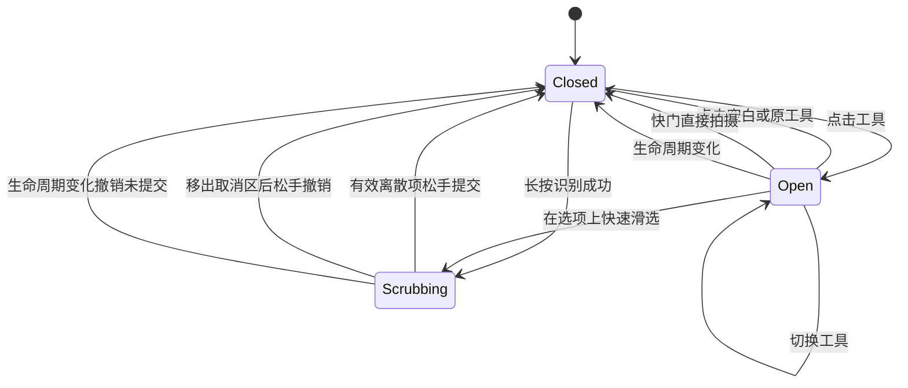

# 右侧工具列与照片比例 · 技术设计

日期：2026-11-02｜状态：待实现｜对应[FS-15](../pr/FS-15-右侧工具列与照片比例.md)、[验收](../ac/右侧工具列与照片比例验收.md)。代码基线ppb-camera@b3b7dad，当前未修改App。

## 1. 组件和状态

建议从CaptureView提取CameraSideToolbar、PeopleCountPanel、GuideStylePanel、ExposurePanel、AspectRatioPanel、PhotoFrameGeometry和CaptureRecipeSnapshot。复用AVCameraSource曝光/翻转、现有ROI、PhotoStore、半圆变焦、调整面板，不复制硬件管线。以下类型为设计草案，工程命名按项目规范。

```swift
enum CameraTool { case people, guides, exposure, aspectRatio }
enum ExpectedPeople { case one, two, three, four, group }
enum GuideStyle { case none, thirds, diagonals, goldenRatio }
enum PhotoAspect { case original, square, portraitThreeFour, portraitNineSixteen }
```

状态划分：

- expandedTool、gesturePhase、pendingDiscreteSelection：临时交互，MainActor；同一时刻一个展开面板。
- expectedPeople、guideStyle、showsCenterPoint、photoAspect：设备本地偏好，单一来源，面板与侧栏共享。
- requestedExposure、appliedExposure、cameraGeneration、requestRevision、hardwareRange：曝光目标和真实状态分开。
- roiRevision、geometryRevision、goalRevision、photometricRevision、identityEpoch：独立上下文；不要将所有参数变动塞进不可解释的generation。
- 每次快门CaptureRecipeSnapshot：photoAspect、source/crop空间、方向/镜像、camera/zoom与版本，创建后不可变。

旧showsGridOverlay偏好：不存在新键时true→thirds，false→none；已有新键优先，非法值回none，不清中心点偏好。若旧状态未持久化则保持旧默认。曝光以硬件为准，不跨设备盲目恢复。当前照片配方数据结构需先核对SharedModels/EditRecipe与PhotoRecord，再做向后兼容扩展，不把旧照片无配方误判损坏。

## 2. 交互状态机和命中



曝光连续拖动有自己的editing阶段；数值应用后不因关闭工具回滚，滑选取消仅适用于人数/辅助线/比例等离散选项。一次手势只提交一次，点击和长按识别互斥，避免先展开再重复选择。长按阈值候选350ms；触觉只在离散高亮项变化时节流，连续像素不逐次触发。

点击空白关闭时由关闭层消费，不透传到对焦/ROI；快门、变焦和工具区域位于关闭层有效命中之上，点快门一次即可拍摄。ROI拖动只在ROI可命中区接收，工具优先；横向滚动列表与按住滑选分模式，VoiceOver提供明确按钮/可调操作。不要用全屏透明覆盖层把所有相机控件锁住。

面板布局按安全区与可用区域求解：图标锚点右侧不动，内容向左展开；先完整显示，超宽时横向滚动/紧凑弹层，超高时允许适配而不覆盖快门。四工具各44pt起的目标区，不通过缩小点击区适配小屏。比例选项按左到右阅读顺序；人数快速滑选按离图标从近到远1/2/3/4/多，分别实现明确索引映射。

## 3. 人数与辅助线

expectedPeople为意图，不是detectedCount。选group不写成“检测到5人”；未实现多人能力时capability不开放多人强引导，仍保存偏好和显示状态。修改人数更新goalRevision并清单人旧建议，不能自动改变被拍对象身份。未来多人能力需独立群体关联/遮挡/边界评测，不把单人关键点函数套外接框就宣称完成。

辅助线使用统一几何绘制：thirds为1/3与2/3；diagonals连接相对角；goldenRatio在约0.382与0.618处绘制，文案说明是黄金分割线，不是黄金螺旋。线条按当前可见框绘制，不参与人体识别。中心点独立：ROI活跃时ROI中心，其余为当前成片框中心，原始模式为画布中心。保持非交互装饰层allowsHitTesting(false)，读屏隐藏。

颜色/透明度以明暗背景测试结果冻结；动态缩放按需调整线宽，不能把覆盖层烘焙到导出图。静态线条/中心点切换不产生网络请求、不改变曝光或zoom。

## 4. 曝光映射与异步应用

按用户方向要求，设滑杆局部横坐标x∈[0,W]（左为0），硬件可用范围[L,U]：

```text
targetEV = U - clamp(x/W, 0, 1) * (U-L)
xForZero = W * U/(U-L)  // 仅当L<=0<=U且U>L
```

若范围只有一个值则禁用；不包含0时恢复默认按设备支持策略钳制并说明，不能伪造0已应用。通常合理范围与硬件取交集复用ExposureBiasRange。读屏增量语义仍是“增加曝光/减少曝光”，不受视觉方向反转影响。

手势更新requestedExposure；现有约150ms合并窗可作为起点，只保留末次下发。后台sessionQueue执行配置，等待可用的完成/确认时机后读回appliedExposure；在实现前验证现有nil completion后立即读回的时序。不能显示拖动目标为已应用。

每次请求携带cameraGeneration＋requestRevision；返回时两者仍匹配才更新UI，旧回执不覆盖新值。关闭面板后，已接受的最后一次设置必须由独立控制器完成或明确取消并刷新硬件；不能因View消失而留下UI和硬件分裂。恢复默认是新请求，晚到旧滑动回执不得覆盖。切镜/中断后清旧设备请求并读取当前硬件范围，失败保留最后确认值并提示。模拟器不构造假硬件成功。

## 5. 比例、取景与裁切

### 5.1 三种不同范围

保留FS-14坐标域：设备D、upright图像I、屏幕S、ROI R、避让O，新增成片窗口P作为I中的明确矩形。P由PhotoAspect/原图尺寸与可用视野求出；R是分析范围，与P独立。

原始模式：P为完整原片，预览仍aspectFill，屏幕可能只显示P的一部分，保留已知差异。非原始：必须完整展示目标P的有效画面；可使用匹配P的预览区域，外围装饰延展，不把整个屏幕视作成片。视频和照片不同视野时先选相容格式/校准映射，再开放组合，不靠肉眼大概对齐。

### 5.2 中央裁切

对upright原片W×H和目标r=width/height：

```text
若W/H>r: cropH=H, cropW=H*r
否则: cropW=W, cropH=W/r
cropX=(W-cropW)/2; cropY=(H-cropH)/2
```

此为目标窗口计算，不自动代表照片/视频映射。照片方向归一、镜像和输入视野转换在几何快照中确定。边界求交后采用确定的像素取整策略，并用最大可容纳的整数宽高满足目标比例；可按1:1、3:4、9:16的整数倍生成，比例不得靠拉伸校正。若需要缩小输出统一在裁切后等比例缩放，禁止放大插值冒充原生分辨率。

相同比例的3:4与原始内容可能完全相同，但配方语义不同。原始指传感器完整照片，不固定称为3:4。所有照片保持矩形；视图圆角不应裁掉导出图角落。

### 5.3 拍摄冻结与恢复

按快门时冻结配方和几何，不在capturePhoto返回后读取当前photoAspect。设备/倍率重配置与快门由CameraCore实际可用性串行协调，不能为了AI上锁。相机在途设置改变后，已拍照片仍用旧冻结配方。

顺序：可靠保存完整原片/作品索引→保存冻结配方和renderState=pending→异步生成派生文件→原子写入派生文件/更新索引为ready。原片不可覆盖；失败保留pending/failed并可本地重试。启动恢复扫描孤立临时派生文件、缺失索引和pending项，不能靠UI显示成功掩盖写入失败。

建议字段：recipeVersion、photoAspect、cropRectNormalizedInOriginal、orientationPolicy、geometryVersion、renderState、derivedRelativePath、renderErrorCode。兼容旧文件缺字段为original，无迁移重写原片。原始/成片在同一作品内预览；系统相册导出明确当前版本，导出成片失败不静默换原片。

### 5.4 ROI与辅助线重新映射

切比例递增geometryRevision/goalRevision，清旧快照、Overlay和云候选。保留R的图像归一化位置后与新可分析范围求交；不合法则重新选择，不将R赋值为P。辅助线重绘对齐P，控件避让O只影响UI。部分身体不在R时unknown；原始预览外不可见部位不能凭屏幕几何判照片裁切。

## 6. 上下文失效矩阵

| 操作 | 本地处理 | 云任务 |
| --- | --- | --- |
| 人数改变 | 更新goalRevision，清不适用指令 | ack前拒绝旧目标，必要时取消；不自动重传 |
| 照片比例/ROI/zoom/镜头改变 | 几何/ROI/场景按需递增，清旧结果与跟踪 | 旧context拒绝；不自动收费重试 |
| 曝光真实应用改变 | 更新photometricRevision，重新测光；旧光线结论失效 | 保守作场景输入变化，拒绝旧亮度目标；不自动上传 |
| 仅辅助线/中心点开关 | 重绘，不变照片和分析内容 | 无新任务，不重复ack |
| 切Tab/后台/账号 | 收工具、撤未提交手势、停分析；照片持久化继续 | 维持FS-14终态查询/身份隔离 |

ack已在途的变化不自动改财务终态，按ready/ack/committed查询恢复。原片派生成片不调用AI、不扣次；比例切换也不构成一次分析请求。

## 7. 实施顺序与验证

1. 先建立一个偏好/曝光单一状态源、抽取组件和命中规则，复用原相机与变焦。
2. 完成侧栏、辅助线、曝光、顶部翻转、人数偏好；多人数智能保持真实不可用状态。
3. 独立完成PhotoFrameGeometry、相机视野校准、冻结配方和原片/派生恢复；未完成前不开放可选择的比例假功能。
4. 同步ROI/AI上下文与四Tab目标既有任务，后续多人AI另外验证。

测试：手势提交/取消、图标锚点与小屏、曝光映射单调性和范围不对称0刻度、旧回执、配置迁移、比例整数计算/方向/镜像、冻结后切设置、文件故障恢复、不同画幅真机视野校准、读屏/动态字体、离线零上传。测试执行状态见专项文档，本文不是运行报告。


## 8. 配方合成、版本竞争与删除

推荐渲染顺序：只读原片→按EXIF归一→几何裁切→风格/后期微调→等比缩放与编码。每次从原片重放，不用上一次有损派生文件链式裁切/调色；拍摄硬件EV已烘焙进原片，不能再按同一EV二次处理。CaptureRecipeSnapshot固定拍摄几何；EditRecipe按实际结构兼容扩展为几何与风格独立字段。

保存renderKey=(assetId, recipeRevision, rendererVersion)，只有asset未删除且revision仍匹配才原子发布路径/缩略图/ready状态。旧渲染可被取消或完成为未引用临时文件，禁止覆盖新状态；崩溃恢复核对配方与文件，不只看文件名存在。写入与索引不能跨文件原子提交时，用pending记录和修复流程收口，不原地覆盖当前可导出的文件。

导出/分享请求固定renderKey，等待对应结果或明确失败；导出完成回执关联该版本，不能把旧导出标成新版本成功。编辑与导出并行时允许原请求完成，但UI说明已保存的版本；照片库成功以平台真实回执为准，重试需防止同一请求重复写入。权限拒绝不清配方。

作品删除先写tombstone/assetGeneration，再取消渲染与未开始导出；所有异步回填检查删除代数，不能复活作品。已经交给系统相册的写入不保证可撤销，按真实回执说明，不因App删除静默删除系统副本。派生文件清理只删除无引用文件，原片/当前版本/进行中导出引用不能被误清；具体清理策略沿用StorageKit，并增加竞态回归。

偏好以设备本地最后确认值恢复；临时展开/hover不保存，非法值回默认；已有作品按其配方渲染而不是读取当前拍照偏好。曝光仍以设备为准。调色重置只重置style分量，恢复原画幅使用独立操作；前后对比保持相同几何，完整原片通过单独入口查看。
