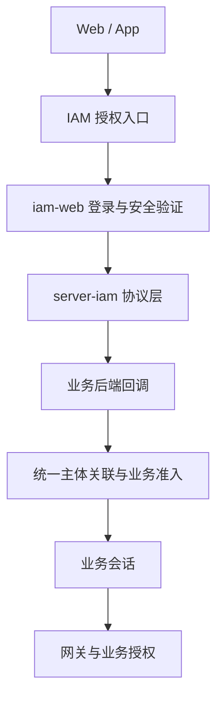

# 技术大纲

> 拟实施契约 v0.4。路径为设计名，非已上线端点。

## 1. 工程与服务边界

ppb-base 新增 server-iam（独立 Go module）、iam-web、iam-manage-web、idl/iam 和部署配置。服务内部按 account、profile、identity、credential、authentication、federation、oauthserver、session、application、platformauthz、audit 分模块，首期模块化单体。

独立 ppb_iam 数据库、迁移、配置、镜像、健康检查与按目录 CI；业务包禁止反向进入 IAM。共享协议/SDK 轻量化、版本化，不引入整个 server-pkg 的业务依赖。SQL基线采用MySQL 8.0.16+；存储接口隔离方言，开发SQLite需单独适配，不直接运行MySQL脚本。迁移和集成测试覆盖实际支持组合。

## 2. 接入拓扑

IAM 同时是上游第三方登录的客户端、下游应用的身份提供方，两条链路独立处理 state、nonce 与凭证。

## 3. 协议端点与规则

| 拟定端点 | 用途 |
|---|---|
| /.well-known/openid-configuration | OIDC 元数据 |
| /oauth2/authorize | 授权码入口 |
| /oauth2/token | 授权码换取与刷新 |
| /oauth2/jwks | 非对称签名公钥 |
| /oauth2/userinfo | 以对应 Access Token 读取获准用户信息 |
| /oauth2/revoke | 撤销令牌/授权，语义在接口契约固定 |
| /oauth2/logout | 经验证的退出请求与允许的返回地址 |

所有元数据与实际 issuer/端点一致。只开放明确实现并验证的流程；首期授权码 + PKCE S256，不开放隐式流或密码授权。授权码短时、单次使用，绑定 client_id、redirect_uri、PKCE challenge；兑换和消费原子执行。

客户端验证签名、允许算法、iss、aud、有效期、nonce；按 OIDC 规则处理 azp 与多 audience。UserInfo 的 sub 与 ID Token 一致。state/nonce 高熵且绑定发起端；登录事务在服务端保存、过期和一次性消费。使用经评估维护的协议库，候选版本、许可证与一致性结果在 P0 固定，不自行拼装密码学。

ID Token 用于登录身份，不是业务 API 凭证。Access Token 必须限定 audience/scope；不得将任意应用令牌作为网关通用凭证。

## 4. Web 与原生客户端

Web 推荐业务后端处理认证和业务会话。/auth/login 创建事务，/auth/callback 换码校验并建立本地会话，/auth/me 查状态，/auth/logout 退出。这些是业务接入端点，与 IAM 协议端点区分。

Cookie 使用 Secure、HttpOnly、合理 SameSite 和最小 Domain/Path；不跨父域共享认证 Cookie。Cookie 鉴权的修改请求必须验证 CSRF/Origin，SameSite 不代替完整 CSRF 防护。回调与事务 Cookie 策略覆盖实际采用的响应模式。

IAM 和各业务通过反向代理尽量同源提供页面/API；协议跳转跨域，不依赖第三方 Cookie 静默认证。登录后会话 ID 轮换，return_to 仅允许本站路径/注册地址。

iOS 使用系统认证会话、独立公开客户端、PKCE 与受控回调；无 client_secret。凭证进入系统安全存储，不经 URL 返回长期 token。业务 token 的换取另定义受控授权契约，不让 App 直接使用 Web 会话。

## 5. 会话、刷新与撤权

IAM 会话、grant、刷新 token family 与业务 sid 建立可查询关联；仅在适当范围下发协议 sid，不泄露全局关联标识。若使用 pairwise sub，按客户端/sector 映射，不假定不同客户端 sub 相同。

刷新凭证保存摘要，单次轮换；检测旧凭证重放时撤销整个 family。请求并发策略需明确，禁止重复刷新产生不受控分叉。访问令牌短时有效，JWT 离线校验不能单独保证即时撤权。

业务首期继续签发自己的 member/manage 会话凭证，保留 biz_key、类型隔离与原授权链路；平台管理会话落platform_admin_sessions并关联统一用户与IAM会话。不得将 IAM token 填进原 HS256 解析器。

禁用/全局退出通过持久化 outbox、已认证事件或明确实现的标准登出机制通知业务，幂等、重试、死信和对账。失效事件包含事件 ID、范围、版本、发生时间，接收方防重放；事件内容最小化。本地撤销会话并清理网关缓存、断开 WS。

高权限请求会话查询失败拒绝。普通业务降级策略、令牌/会话时限、缓存时间、撤权传播上限在 P0 明确为数值，未定不得生产开放，不能宣称即时退出。

## 6. 密钥、安全与运维

非对称签名、kid 标识、私钥受控保存；轮换时旧公钥至少覆盖仍允许验证的令牌寿命，紧急泄露另走撤销策略。client secret 只在后端保存，支持轮换和撤销。

验证码/找回凭证短时单次使用、摘要存储、限流和防枚举；代理来源可信配置后才使用转发 IP。所有管理操作服务端鉴权和审计，IAM 管理员不能自动获得业务超管。

健康检查区分存活与就绪；审计不记录密码、code、token 或完整凭据请求。记录登录成功率、协议失败、刷新重放、撤权积压和回调异常。备份恢复应验证旧会话不会意外复活。

## 7. 规范参考与待定项

协议参考：[OIDC Core](https://openid.net/specs/openid-connect-core-1_0.html)、[Discovery](https://openid.net/specs/openid-connect-discovery-1_0.html)、[PKCE](https://www.rfc-editor.org/rfc/rfc7636)、[OAuth 安全实践](https://www.rfc-editor.org/rfc/rfc9700)、[原生应用](https://www.rfc-editor.org/rfc/rfc8252)、[Token 撤销](https://www.rfc-editor.org/rfc/rfc7009)。这些是实施参考，文档不声称已通过一致性认证。

P0 固定：issuer、公开/机密客户端策略、subject 策略、开发方言适配、协议库版本、会话与 token 时限、MFA/恢复方案、撤权时限、HA/恢复目标。SCIM/SAML、动态客户端注册和集中业务授权另立 ADR。

## 8. 当前账号与授权落点

server-user的通用账号、公共资料、认证及平台授权合并迁入server-iam；聊天组织/成员/部门/角色移server-im。跨服务统一内部用户ID，外部OIDC subject通过subject_mappings隔离。平台普通授权按角色菜单按钮推导，详见[授权需求](../pr/03-平台角色菜单权限.md)。

所有物理列采用至少两个单词snake_case；协议标准JSON名保持不变。列、编码、索引以[SQL](sql/schema.sql)为准，完整范围见[数据模型](数据模型.md)。会话与资源权限必须检查deleted_flag、状态、时限及授权版本。
