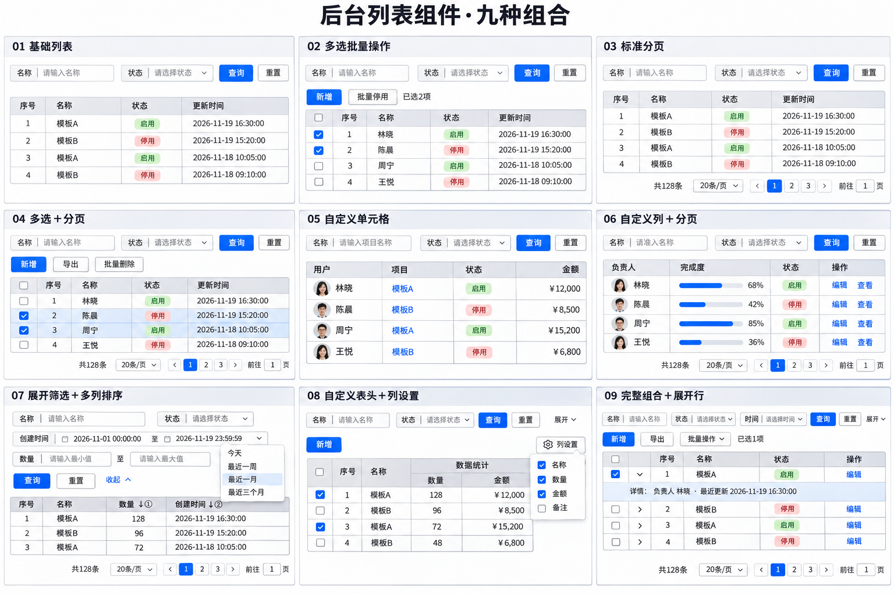

# ProTable 图片风格改造与调整清单

更新：2026-11-19。状态：待执行说明，尚未修改组件代码。

## 改造结论

重构后的 ProTable 与参考图在整体风格和区域布局上大致一致：白底、紧凑筛选、浅灰表头、横纵细边线、蓝色主按钮、统一底部分页。九宫格表示同一个组件不同配置下的效果，不是九套独立样式，不要求逐像素复制图片。

本次在现有 `ppb-base/base-manage-web/src/components/ProTable.vue` 上改样式、布局并增补必要配置。保留请求机制、受控/非受控模式、状态管理、公开调用、权限与业务操作。不要把本任务扩大为列表架构重构，不强制引入 useProList、ProList 或替换数据源。

## 图片基准

图片上方大标题、01～09 编号和示例名称是展示说明，不能复制进实际业务页面。实际页面占满可用内容宽度，不把九张小图的宽度当组件固定尺寸。

## 需要调整的内容

| 区域 | 样式与布局要求 | 交互或配置要求 |
| --- | --- | --- |
| 整体容器 | 白底、细边框、小圆角，统一内边距 | 保留现有页面壳和路由布局 |
| 筛选区 | 标签与控件共用一个外边框，标签右侧细分隔，统一高度 | 默认一行，可展开；查询/重置始终可见，折叠不丢值 |
| 时间筛选 | 范围控件适当加宽，窄屏可占整行 | 时分秒、今天、最近一周/一月/三月；格式兼容现有接口 |
| 工具栏 | 筛选下方独立一行；左业务操作，右辅助操作/列设置 | 没有按钮或插槽内容时不留空行，不擅自添加按钮 |
| 表格 | 浅灰表头、横纵细边线、统一行高和选中背景 | 多选列与序号列分别开关，保留原选择行为 |
| 列内容 | 文字靠左、数值靠右、状态与序号居中作为预设 | 页面可覆盖 align/headerAlign/width/minWidth/fixed |
| 长内容与时间 | 长文本省略并提示，时间尽量单行完整展示 | 0/false 正常显示；保留 clamp 和业务插槽 |
| 表头排序 | 标题与排序图标间距稳定，方向清楚 | 升序→降序→取消，仅开放接口实际支持的排序 |
| 自定义列 | 头像、链接、开关、进度条、按钮遵守行高和列宽 | 单元格和表头插槽仍保留对齐、固定、宽度和排序能力 |
| 列设置 | 工具栏右侧入口，浮层与控件风格一致 | 显隐、顺序、宽度、恢复默认；按用户/页面/范围隔离偏好 |
| 分页 | 统一右下布局，总数、页大小、页码、跳页 | 可关闭；隐藏时无空白，保持原事件和分页逻辑 |
| 页面适配 | 窄屏、侧栏缩放、固定列、内部滚动都保持稳定 | 加载、空数据、错误重试仍可使用，不新增重复请求 |

## 不能机械照搬的部分

- 时间列宽不足时优先调整 minWidth 或允许横向滚动，不把完整时间挤成多行。
- 筛选增加时不能挤走查询/重置；必要时操作区单独成行。
- 固定列滚动时背景、遮罩和边框完整，不产生双线或错位。
- 按钮、标签和输入尺寸以当前 UI 体系为基础统一，不为了像缩略图而缩小到难以操作。
- 图 07 的多列排序仅在接口支持时实现；只支持单列时不显示虚假优先级。
- 参考图中的模拟总数不能用于游标页面；未加载全量仍显示已加载数量。

## 实施步骤

1. 检查现有 ProTable、类型、样式和使用页面，保留已有未提交修改。
2. 先调整容器、筛选、工具栏、表格、分页样式，使基础分页页接近图片。
3. 在现有 props/类型上增量补充列属性、可选序号和分页开关；避免破坏默认调用。
4. 增强筛选、时间快捷项、排序和列设置，延续现有请求与事件路径。
5. 验证九种组合、宽窄容器、fixedFoot、现有业务插槽及用户管理页。
6. 运行适当回归、类型检查和构建，记录真实结果与截图。

## Claude Code 执行提示

> 请以本文件和 09-visual-style-and-layout.md 为视觉基准，在现有 ProTable.vue、pro-table.ts 及其样式上增量改造。保留请求、状态管理、公开接口和业务操作；不新建列表架构。参照 03～08 的能力要求，按 10 的顺序实施，以 11 验收。九宫格是同一组件的组合展示，不复制演示标题，不虚构后端能力。完成后在 implementation.md 记录修改、API 增量、截图、测试结果和未完成项。
