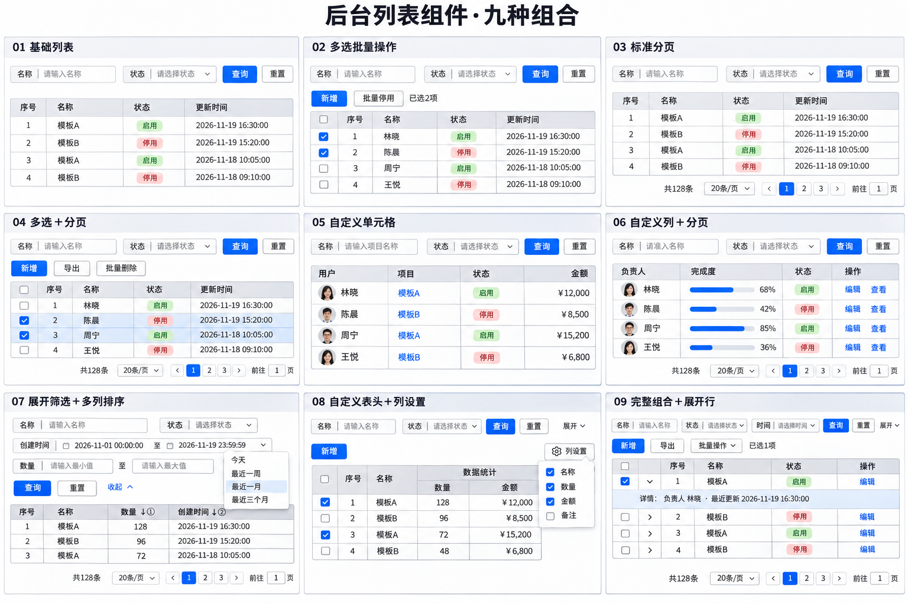

# 09 全部样式规范与页面布局

更新：2026-11-19。状态：待实施规范。执行前先读 [README](./README.md)，本文不代表功能已实现。

## 视觉目标与本轮边界

现有 ProTable 重构后应与参考图风格、区域布局大致一致；不是像素级复制，也不是新建列表架构。细节调整清单见 [00](./00-style-refactor-checklist.md)。图片编号、标题和缩略图宽度不进入业务页面。保留现有请求和状态机制。

## 样式与页面高度

白底、浅灰表头、横纵细边线、小圆角、紧凑间距；使用统一 CSS 变量管理背景、边框、文本、控件高、行高、间距及密度。不通过大量深层选择器覆盖其他页面或全局 Element Plus 样式。

保留自然高度与 fixedFoot 两种布局。固定底部模式要求宿主提供高度，祖先与表格滚动容器正确设置 min-height:0；筛选与分页固定、表格内部滚动，不出现双重垂直滚动。窄屏允许表格横向滚动，分页不被截断。按钮、复选框和排序保持焦点、键盘操作与可访问名称。

参考图只用于视觉对齐，交互和能力以本文为准：



## 区域结构

```text
┌ 白底列表容器 ──────────────────────────────┐
│ [标签│控件] [标签│时间范围] [查询][重置][展开] │
│ 展开后额外条件（折叠不丢值）                 │
│ [新增][批量操作]                 [列设置]    │
│ □ 序号 │ 标题 ↑↓ │ 状态 │ 创建时间 │ 操作   │
│        横向与纵向细边线、浅灰表头             │
│ 错误/空态/加载态在对应区域清楚展示             │
│                  总数 / 页大小 / 页码 / 跳页 │
└───────────────────────────────────────────┘
```

## 建议设计变量

以下是新紧凑列表的初始样式值，需结合参考图与现有主题目测校准；所有值集中定义，不能散落于业务页面。

| 变量 | 建议值 | 用途 |
| --- | --- | --- |
| --pro-list-bg | var(--el-bg-color, #fff) | 容器与控件背景 |
| --pro-list-header-bg | var(--el-fill-color-light, #f5f7fa) | 表头 |
| --pro-list-border | var(--el-border-color-lighter, #e4e7ed) | 容器/表格边线 |
| --pro-list-text | var(--el-text-color-primary, #303133) | 正文 |
| --pro-list-muted | var(--el-text-color-secondary, #909399) | 辅助文字 |
| --pro-list-radius | 4px | 容器/输入小圆角 |
| --pro-list-padding | 12px | 紧凑容器内边距 |
| --pro-list-gap | 8px | 区域及字段间隔 |
| --pro-list-control-height | 32px | 紧凑输入与按钮高度 |
| --pro-list-font-size | 13px | 正文建议值 |

密度预设 compact/default/comfortable 建议行高分别为 36/44/52px，控件高 32/32/40px；实际行高允许业务单元格内容撑开，不能通过固定 height 截掉开关或多行文字。本次有意将 ProTable 外观统一为图片风格；保留业务 API 和交互默认值。先用试点检查样式影响范围，再覆盖其余消费者；确有特殊视觉需求时由显式配置覆盖。

## 分区细则

- 筛选：标签不另占一行；标签区与控件区细分隔，保留表单错误提示空间，focus 边框与禁用样式可辨。日期范围占较宽空间，窄屏可整行。
- 工具栏：与筛选、表格间距一致，左业务按钮右辅助入口；选中数量不挤压操作。
- 表格：启用真实 border 能力，外框与单元格边线不叠成粗线；斑马纹可选，固定列遮罩和背景完整。
- 表头：浅灰底、可读字重、标题与排序图标有稳定间距；对齐跟随配置，不强制全居中。
- 单元格：文字左、数值右、状态居中仅为预设，页面可覆盖；时间不换行，超长列通过宽度与 tooltip 处理。
- 操作列：固定右侧按需启用，按钮过多时页面提供“更多”，不无限拉宽或让按钮覆盖内容。
- 分页：右对齐，窄屏换行/简化 layout；不能让跳页输入溢出；隐藏时无留白。
- 状态：首载 skeleton/spinner、刷新 loading、空数据、失败重试语义不同；错误区域不覆盖可操作按钮。

## 高度、滚动与响应式

自然高度用于文档流页面，fill/fixedFoot 用于后台可用高度。固定页脚不是 position:fixed 到浏览器底部，而是列表 flex 布局内固定区域。表格容器 flex:1、min-height:0、min-width:0，只有表格主体产生纵向滚动。横向滚动时固定列/表头不脱节。

按容器宽度测试 1440、1024、768、375px 及侧栏开关；断点可以调整，但 ResizeObserver 必须响应实际容器。窄屏优先保证查询/重置可见、字段可操作、表格可横向滚动；不要通过整体缩放文字解决拥挤。

## 主题和可访问性

复用 Element Plus 主题变量，避免硬编码一组白色后破坏现有主题。若项目有深色主题，至少验证背景、分隔线、固定列、hover/selected/disabled 的对比。排序按钮、列设置、复选框、展开/收起均可键盘访问；图标按钮有名称，焦点环不被 overflow 截断。

## 视觉验收

九种组合分别提供真实实现截图；另截图窄容器、展开筛选、fixedFoot 滚动、固定列、错误/空态及密度切换。不得只用原九宫格概念图声称实现完成。截图不能暴露真实敏感用户信息。

---

返回 [文档入口](./README.md)；执行及交付要求见 [迁移计划](./10-migration-and-claude-task.md)。
