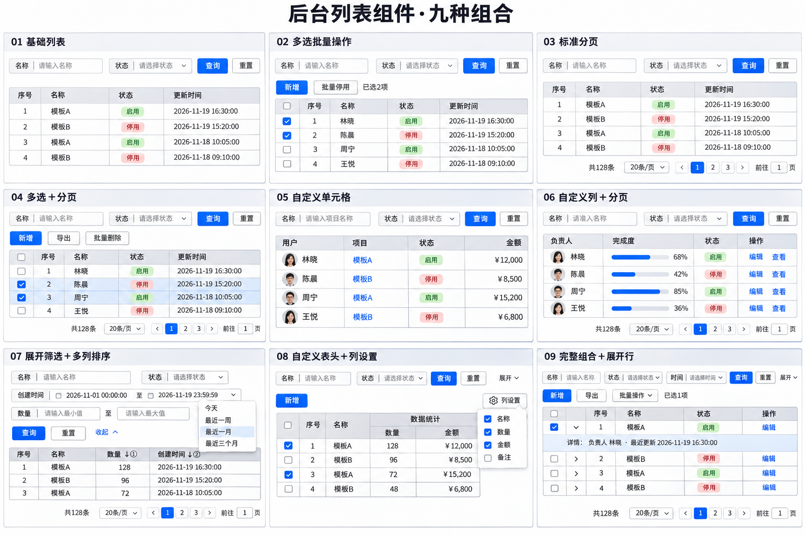

# 现有 ProTable 样式与配置改造文档

更新：2026-11-19。供 Claude Code 在原项目上执行；当前为设计规范，尚未执行代码改造。

本目录由原 `table.md` 拆分并补充，不另建平行组件框架。保留原需求、九宫格图片及旧 ProTable 兼容约束。此 README 是唯一执行入口，各专题分别维护其规则，`table.md` 仅保留旧链接入口。

## 本次确认的范围（优先遵守）

以现有 ProTable 样式重构为主，参考九宫格达到大致相同的风格和布局，并补齐筛选、排序、列属性、插槽与列设置。保留原有请求、状态和业务调用，不做完整列表架构重构。此前要求强制引入 ProList/useProList 或统一数据源的内容已取消。

请先阅读 [00：图片风格改造与调整清单](./00-style-refactor-checklist.md)，再读 09 的样式细则、03～08 的增量能力，按 10 执行、11 验收。

## 文档与阅读顺序

| 顺序 | 文档 | 内容 |
| --- | --- | --- |
| 01 | [架构与兼容](./01-architecture-and-compatibility.md) | 现有组件修改位置、旧 API 与业务兼容 |
| 02 | [数据源与状态](./02-data-source-and-controller.md) | 保留原请求、查询、分页与数据模式 |
| 03 | [表头排序](./03-header-sorting.md) | 三态排序、默认值、映射、本地比较、多列增强 |
| 04 | [筛选与时间](./04-filters-and-time.md) | 控件、远程选项、联动、校验、快捷项、单行折叠 |
| 05 | [自定义列与插槽](./05-custom-columns-and-slots.md) | 插槽上下文、渲染优先级、手写列与兼容 |
| 06 | [列与表格属性](./06-column-properties.md) | 对齐、宽度、固定、溢出、分组及整体属性 |
| 07 | [列设置与用户偏好](./07-column-settings-and-preferences.md) | 显隐、顺序、宽度、密度、存储与恢复算法 |
| 08 | [选择与工具栏](./08-selection-toolbar-and-actions.md) | 单复选、序号、批量操作、确认与权限适配 |
| 09 | [全部样式与布局](./09-visual-style-and-layout.md) | 设计变量、分区样式、响应式、固定底部及主题 |
| 10 | [迁移计划与执行任务](./10-migration-and-claude-task.md) | 阶段、试点、交付、可复制的 Claude Code 提示词 |
| 11 | [测试与验收](./11-testing-and-acceptance.md) | 九种组合、回归、命令、证据与完成标准 |

先完整阅读，再按 10 的顺序执行；不是按文档编号逐个独立创建组件。使用仓库内实际路径和适用规范，不机械照搬示意 API。

## 本轮与后续范围

本轮交付以 00 清单为准：图片风格、筛选折叠与时间快捷项、实际可用的排序、列属性与插槽、选择/序号/工具栏/分页展示、列偏好、九种组合验证。保留原业务逻辑，不要求拆分基础组件或引入控制器。多列排序需接口支持；查询方案、URL 条件记忆、虚拟滚动等为后续增强。

冲突时以用户本次确认、00 的范围和 09 的视觉要求为准；旧业务兼容以 01/02 为准。专题里的目标 API 示例采用增量兼容方式，不强制更换组件名、类型名或旧插槽。

## 直接开始

将 [10 的执行任务](./10-migration-and-claude-task.md) 中代码块交给 Claude Code，并让它先读此 README。执行结果写入本目录 implementation.md；本次文档整理不预创建虚假的实施结果。

