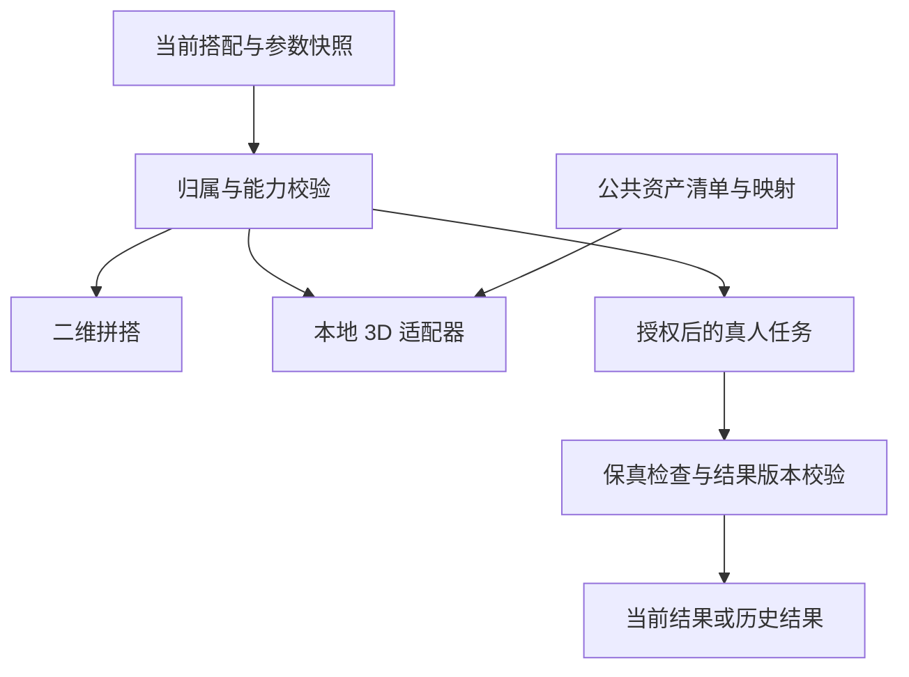

# 形象与试穿技术设计

v1.3 · 2026-11-02 · 提议架构，未接入服务/未完成实机验证。

[详细需求](../pr/09-形象管理与真人预览.md) · [验收](../ac/09-形象管理与真人预览.md) · [PRD](../PRD.md)

## 1. 选型结论与边界

建议把 **穿搭组合、参数化 3D 渲染、二维真人生成** 拆成独立模块。Outfit 中真实 garment_id 列表为事实来源，任何表现资产都不能反向伪造衣物。输入照片不能直接成为可换装三维网格；渲染引擎也不自带衣物重建、体型估计或布料适配。

| 层 | 提议实现 | 验证/限制 |
| --- | --- | --- |
| iOS | 原生 UI + RealityKit 渲染适配器，USD/USDZ 发布资产 | 按最低 OS 验证骨骼与 blend shape API、导出链路；不兼容时静态/二维 |
| Web 个人端/后台 | Three.js + glTF/GLB，骨骼、morph targets | 固定依赖版本、兼容列表和 GPU 能力检测；WebGL 不可用则二维 |
| 资产制作 | 同一 DCC 源文件、统一骨架和语义参数清单，分别导出 USDZ/GLB | 不假设两格式运行时效果天然一致；逐资产跨端截图/参数回归 |
| 本地数据 | SQLite 或现有本地库 + 私有文件目录 + 变更队列 | 不在未阅读 App 源码时锁死具体持久化框架 |
| 服务端 | 现有业务 API + 对象存储 + 队列/任务表 + 独立 GPU/供应商适配器 | 文档仓库不含 App 技术栈；落地前读取实际项目，不另造重复账号系统 |
| 真人生成 | 支持人像+衣物条件的已授权 VTON 服务/模型 | 技术验证选型后接入，不能用普通文生图代替服饰保真 |
| 推荐 | 先硬约束校验，再规则/模型排序 | 无尺寸数据不输出准确合身结论 |

Apple 文档描述 mesh、skinning 和 blend shape 能力；Three.js 官方文档描述 glTF 资产和骨骼/形变支持。以上组合是本项目建议，框架能力不等于已做好可调体型衣服。

### 1.1 iOS Swift 是否支持 Three.js

支持通过 **WKWebView 嵌入**，不是把 JavaScript 库直接 import 到 Swift。SwiftUI 通过 UIViewRepresentable 承载 WKWebView，Three.js 在 WebKit 的 JavaScript/WebGL 环境中运行。Swift 继续负责照片权限、相机、本地数据库、授权、同步与任务。当前 WebGLRenderer 使用 WebGL 2，必须在目标 WKWebView 中运行时检测，不按“iPhone 支持浏览器”推断全部设备可用。

| 路线 | iOS 页面 | 3D 运行位置/资产 | 取舍 |
| --- | --- | --- | --- |
| A 原生（当前建议先验证） | Swift/SwiftUI | RealityKit，USDZ | 更直接控制原生生命周期；Web 另写 Three.js 渲染适配，双格式/视觉一致性需验证 |
| B 共用渲染（可选） | Swift/SwiftUI | WKWebView + Three.js，GLB | App/Web 可复用场景、发型和 morph 逻辑；增加消息桥、Web 内容进程、资源加载与手势协调成本 |

不以未经测试的性能结论直接选择；用同一人体/发型/服装/极值参数小样比较加载、帧时、内存、温升、交互与离线，再记录引擎决策。首轮只落地一条 iOS 路线，不要求并行维护两套生产引擎。参数语义、asset_manifest 与 outfit 数据独立于引擎。

路线 B 的实现契约：

1. Three.js、HTML、着色器、解码器、基础 GLB/纹理随 App 打包或经授权下载到受控目录，不依赖在线 CDN。WKWebView 加载本地入口，资源采用受控本地 scheme handler/经验证文件读取范围；同时测试模块、纹理、GLB 和解码器可离线加载，不能仅验证 HTML 打开。
2. 页面 ready 握手后发送完整快照；Swift → JS 使用 callAsyncJavaScript 的 arguments 传结构化数据（按最低 OS 检查可用性），避免拼接用户文本到 JS。JS → Swift 用 WKScriptMessageHandler；消息约定 protocol_version、request_id、snapshot_version、command_type、payload。
3. 命令白名单 loadAvatar、applyParameters、applyOutfit、setCamera、pause、dispose；事件 ready、assetLoaded、renderComplete、selectionChanged、renderError。ACK/错误与 request_id 对应，过期快照不应用；大模型和纹理不以 base64 跨桥反复传送，只传受控资源 ID。
4. 滑杆在网页内更新画面，向 Swift 合并发送语义值/结束事件；Swift 持久化为权威。桥接不逐帧传网格/截图；随机、锁定及保存由原生状态协调器决定。
5. 仅信任已打包/校验的页面入口；拒绝任意外部导航并限制消息主框架与可信 origin，校验 schema、长度与版本。认证 token、供应商 key 不进入通用网页上下文，云端生成仍由原生/自有服务处理。
6. 进入后台暂停 requestAnimationFrame；离页移除监听/消息 handler、释放 geometry/material/texture/renderer。Web 内容进程终止或 GPU context lost 后，从已保存快照重建；失败保持二维，不能丢衣柜或重复生成收费任务。
7. SwiftUI 原生玻璃控件覆盖在 WKWebView 上；定义触摸区域，原生部位栏/下方按钮不被 canvas 截获。VoiceOver 等效操作由原生控件提供。
8. 同一资产在 WKWebView 与桌面浏览器分别测；额外测相机返回、屏幕旋转、后台恢复、20 次进出、进程终止、context lost、协议乱序/重复/无效消息和资源离线失败。

官方依据：[WKScriptMessageHandler](https://developer.apple.com/documentation/webkit/wkscriptmessagehandler)、[WKWebView evaluateJavaScript 与 callAsyncJavaScript 相关 API](https://developer.apple.com/documentation/webkit/wkwebview/evaluatejavascript(_:completionhandler:))、[Three.js WebGLRenderer](https://threejs.org/docs/pages/WebGLRenderer)。桥接协议与路线建议为本项目设计，尚未编写 App 实现。

## 2. 模块与数据流

客户端 AvatarEditor 管草稿；AvatarRepository 管持久版本；PreviewCoordinator 统一模式、可用性、快照 hash；RendererAdapter 只消费受支持参数；TryOnClient 不直接接商业模型密钥。服务端按任务输入版本校验资源归属和授权，不信任客户端传来的任意图片 URL。

## 3. 参数化形象与衣物资产

### 3.1 模板制作

1. 制作有授权记录的人体基础网格、中性预览姿态、统一比例/坐标/骨架版本。
2. 由美术建立胸腰臀、肩宽、腿长、整体丰满度等 blend shapes 及组合修正形变；只拉伸全身缩放不能实现体重变化。
3. 各服装模板绑定同骨架，提供相匹配形变或经验证的包裹变形；肩/腋/胯等极值配 corrective shapes。隐藏被服装覆盖的局部身体面作为辅助，不能掩盖明显穿模。
4. 发型绑定头部锚点，发色为材质参数；帽子记录兼容/隐藏规则；包/鞋/配饰使用定义好的锚点与支持姿态。
5. 一份 source_asset 经流水线输出 GLB、USDZ、LOD、缩略图、语义参数映射和内容 hash；对默认/边界/组合参数逐一测试。
6. 发型、人体模板、服装均登记商业使用授权、来源、版本、支持范围和发布状态；未知授权不得上生产目录。

身高以基础高度统一尺度，再应用比例形变；体重仅作粗略体型先验。mapping_version 把可选测量映射到模板权重，已填写三围优先，缺值保持未知；视觉微调作为独立覆盖层。所有输入有限数值校验，权重限于支持域。无法支持的真实值原样保存在测量表，渲染层不得静默 clamp 后声称准确。

### 3.2 衣物映射分级

| representation_kind | 来源 | 显示规则 |
| --- | --- | --- |
| cutout_2d | 照片原像素/蒙版 | 真实单品平面展示 |
| template_proxy | 类别+版型映射+示意颜色/纹理 | 明示“款式示意”；不承诺口袋/背面/褶皱一致 |
| authored_3d | 人工建模/已授权三维源，经校验 | 记录对应 garment 和校验版本，仍不保证合身 |
| reconstructed_3d | 后续 AI 重建 | P2，生成来源与未知背面标识 |

单张前视图无法验证背面，不将纹理投影到模板称作精确建模。无映射时保持 outfit 引用，显示缺少该衣物 3D 表现，并提供整体二维；不得用默认白衬衫冒充用户印花衬衫。P1 仅预定义静态姿态和真旋转，布料动态解算另立 P2。

## 4. 数据模型（逻辑表，可据现有库适配）

所有实体使用稳定 UUID、owner_profile_id、entity_version、created_at、updated_at、deleted_at；公共资产表 owner 为平台，私人表不可混用。字段遵循多词下划线命名。

| 表 | 关键字段 | 规则 |
| --- | --- | --- |
| avatar_profiles | avatar_profile_id、owner_profile_id、active_revision_id、display_name | 首轮每本地身份一个活动形象，历史修订保留 |
| body_measurements | measurement_id、avatar_profile_id、height_cm、weight_kg、chest_cm、waist_cm、hip_cm、shoulder_cm、inseam_cm、measurement_source、measured_at | 全可空；原始测量与推断分离，单位规范化 |
| avatar_revisions | avatar_revision_id、avatar_profile_id、template_asset_id、hair_asset_id、hair_color_value、skin_tone_id、measurement_version、visual_parameters_json、mapping_version | 不可变修订；变更创建新版本 |
| style_preferences | preference_profile_id、fit_preference、trouser_length_preference、formality_level、warmth_preference、preferred_colors_json、excluded_tags_json | 供推荐排序，不当作身体事实 |
| person_references | person_reference_id、owner_profile_id、image_asset_id、reference_version、consent_record_id、quality_status | 真人底图独立授权与删除 |
| avatar_asset_versions | asset_version_id、asset_kind、source_version、rig_version、supported_parameters_json、supported_platforms_json、license_record_id、content_hash、manifest_json、release_status | 公共资产发布/回滚不可改写已发布版本 |
| garment_representations | representation_id、garment_id、garment_version、representation_kind、asset_version_id、mapping_confidence、review_status | 私人衣物与公共模板分开 |
| preview_snapshots | preview_snapshot_id、outfit_id、outfit_version、garment_versions_json、avatar_revision_id、reference_version、effective_parameters_json、render_config_version、snapshot_hash | 不变快照；保存 mode、来源与能力边界 |
| preview_results | preview_result_id、preview_snapshot_id、task_id、result_asset_id、quality_status、stale_reason | 生成结果不写回原图 |
| avatar_sync_changes | change_id、entity_type、entity_id、base_version、operation_id、deleted_at | 可并入已有 SyncChange，支持墓碑 |

draft 存本地独立表，非保存修订；export_manifest 新增 schema_version 和形象/测量/照片/派生资源引用。图片、测量数值和人脸不进普通日志/埋点。导出敏感内容前可选择范围。

## 5. API 草案与一致性

接口沿用现有身份系统；游客只调本地 repository。以下 /v1 为设计草案，实施时与现有路由规范对齐。

| 接口 | 主要输入 | 输出/异常 |
| --- | --- | --- |
| GET /v1/avatar-profile | 当前账号、设备空间 | 自己的活动形象/版本，不能传其他 owner 绕权 |
| PUT /v1/avatar-profile | base_version、operation_id、测量/视觉参数/偏好 | 新 entity_version；冲突 409，返回可比较版本摘要 |
| GET /v1/avatar-assets/manifest | 平台、引擎版本、rig_version | 授权且已发布的兼容清单、hash、LOD、参数域 |
| POST /v1/person-references | 已完成校验的 asset_id、consent_record_id | 底图版本、质量状态；拒绝多人/不支持图 |
| POST /v1/try-on-tasks | operation_id、outfit_version、garment_ids/versions、avatar_revision_id、person_reference_id/version、render_config_version | task_id、input_hash、预占额度；未授权/资源版本失效不送供应商 |
| GET /v1/try-on-tasks/{task_id} | 当前身份 | 状态、错误码、输入快照、已授权结果地址 |
| POST /v1/try-on-tasks/{task_id}/cancel | operation_id | 取消状态；不能取消的执行标明状态并禁止回写当前 |
| DELETE /v1/avatar-profile | base_version、删除范围、是否清理派生图 | deletion_request_id、处理状态、完成/备份到期时间 |
| POST /v1/admin/avatar-assets | 资产清单、授权记录、兼容与回归报告 | 草稿→校验→预发布→灰度→发布/回滚；角色审计 |

照片采用受控上传/短期下载地址与归属校验；上传过期、hash 不符、格式不支持分别报错。POST/PUT 同一 owner+operation_id 幂等；同键不同负载返回冲突。乐观锁不允许静默丢失 Web 或手机修改。管理员不能写私人身体数据。

try_on_snapshot_hash = hash(owner_namespace + mode + 有序的 garment_id/衣物版本/蒙版hash + person_reference版本 + 模型实际消费参数 + model/prompt/render版本)。3D hash 另包含 avatar_revision、模板/服装/发型资产版本、姿态与相机。键只能在当前用户命名空间复用，不能跨用户命中敏感结果；发型这种未用于真人任务的字段不纳入其有效参数。
提交时原子写快照、任务与账本预占（如收费）；队列发布使用 outbox/等效补偿机制。回调验签、去重，再核对 owner、删除墓碑、输入版本；旧任务结果进入历史且带过期状态，不更新当前预览指针。

## 6. 真人试穿流水线

1. 本地选本人/获授权照片，校验方向、分辨率、单人完整度及遮挡；保留原图，质量不符先引导重拍。
2. 用户选择真实 outfit；服务端检查单品存在、属于本人、可用且版本一致，解析模型 capability（支持品类、多件叠穿、包鞋等）。
3. 授权只上传本次必要的底图、衣物图/蒙版和模型确实需要的参数；不默认上传全部测量和衣柜。
4. 服务端产生 immutable snapshot、输入 hash 与任务。参考预处理包括人体解析、姿态/服饰区域蒙版，具体由模型适配器决定。
5. VTON 输出图，经自动筛查+用户确认；关注身份、图案、颜色、衣物数量和边界，失败/变形保留原组合。未经评估不把多次单件生成串联称为保真整套换装，前件可能被后件改坏。
6. 图片加 AI 生成标识、保存来源版本与限制；仅当 snapshot 仍匹配当前组合才设为当前结果。
7. 用户换衣只把真人预览设待更新，点击生成再执行；不对滑杆/旋转/随机逐次收费。

**身体参数与真人一致性**：首轮采用真人底图的实际轮廓/姿态；测量可参与推荐而非修改照片。发型与视觉比例属于 3D 编辑，不自动改变真人。若供应商支持体型控制，须另立能力、评估和显式重新生成操作后才能开放，不能把提示词中的“身高 175”视为几何约束。

供应商选择需记录输出支持品类、授权、数据区域、保留/删除能力、超时/取消语义、单价和 P95 时延。IDM-VTON 可作研究流水线参考，但其仓库代码/检查点标明 CC BY-NC-SA 4.0，不能默认直接商用；商业接入须取得相应许可或选择其他可商业使用方案。研究样例不等于已选生产模型。

## 7. 离线、缓存与删除

- 已打包/下载且兼容的模板可本地改发型、身体形变、保存；资源不存在时不给“已成功渲染”状态，可等下载或二维。
- 3D 参数修改不需服务器推理；模型/资源下载由用户触发或在已授权更新策略内进行，只有联网本身不是上传许可。
- 纹理、网格按 hash 缓存；优先清理可再生派生资源，不能清掉唯一原图、测量或已确认搭配。后台暂停渲染，离页释放 GPU 引用。
- 退出账号清理私人渲染/真人缓存及内存引用；缓存隔离按 owner namespace，公用资产可共用。
- 身体、底图、派生图同步分别控制；冲突保留本机草稿与远端，用户确认后创建新版本。文件迁移保持同样 schema 校验。
- 删除先写 tombstone 并取消/抑制关联任务回写，清理本地/对象存储/供应商副本并跟踪结果；在途供应商不可取消则等待结果后删除，不能恢复到用户相册。
- 建议运维目标：服务可控的在线副本 24 小时内清理；备份按最长 30 天到期，恢复时重放删除墓碑。均为提议，发布前冻结且 UI 显示真实承诺；供应商不能满足已承诺删除期限时不得启用。
- 历史可保留 garment 清单和非敏感搭配元数据；用户要求清理的人像/测量不因历史引用永久保留，资源占位并解释。

## 8. 性能预算与验证门槛

以下是新能力的**拟定目标**，不是实测结果；开始验收前冻结基准 iPhone、最低 OS、Web 档位/浏览器、网络和 GPU。未冻结或无测试报告视为阻塞。

| 项目 | 首轮目标 | 方法 |
| --- | --- | --- |
| 3D 操作 | 中档设备正常档 P95 帧耗时 ≤33.3ms；参数到画面 P95 ≤150ms | 连续 5 分钟旋转/换发型/调参，记录帧时、温升、内存 |
| 3D 首次可交互 | 本地已缓存完整资产 P95 ≤3 秒 | 冷开 30 次；下载耗时另报，不混入缓存指标 |
| 资源预算 | 默认人体+头发+一套模板合计 ≤100k 三角面、常用纹理 ≤2K、压缩下载 ≤30MB | 发布流水线检查；可调但需评审新预算 |
| 内存稳定性 | 约定测试设备下应用峰值 ≤300MB；20 次进出舞台后稳定内存较首轮增幅 ≤10% | OS/GPU 工具；发生内存压力必须及时降级 |
| 变形/兼容 | 冻结测试矩阵严重穿模/破面/错锚点 0 | 默认/极值/组合体型、各支持姿态、各声明支持的衣物/发型组合 |
| 真人任务 | 指定网络、输入分辨率和模型下端到端 P95 ≤90 秒，超过则可离页查询 | 至少 50 次，排队/推理/下载分段报告 |
| 真人保真 | 至少 100 组授权图，两位评审独立评；身份、类别数量、主色、关键图案/细节每项 ≥90%通过 | 分歧由第三人裁定；按体型/肤色/类别分组，不用平均掩盖不支持项 |
| 一致性与费用 | 旧结果覆盖当前、越权资源、重复扣费均为 0 | 换搭中回调、删除中回调、并发保存、断网重试、账号切换故障注入 |

质量不足则收窄支持品类/模板或关闭生成开关，保留组合与二维。用户确认“就穿这套”才写 WearLog，任何模型成功或形象保存均不计穿着。

## 9. 实施拆解与验证产物

- D1：冻结参数域、统一骨架与资产授权清单；用一个模板验证两端同参数一致性、身高/体型变形和三种发型。
- D2：实现本地编辑草稿/修订、PreviewCoordinator、二维/3D 同 outfit 切换，加入缺失映射与设备降级。
- D3：实现个人同步、冲突、导出删除和公共资产后台，接入权限/审计；完成 TC-AVA-01～06、09～12。
- D4：供应商小样评估与许可通过后接入真人队列、账本、版本缓存和保真检查；执行 TC-AVA-07～09 及完整回归。
- D5：单独评审 P2 衣物重建/物理仿真，不延用 P1 模板示意的验收结果。

交付需提供接口契约、数据库迁移与回滚、固定资产版本、依赖锁文件、测试设备报告、网络抓包、错误恢复录屏、费用对账。本文未读取 App 源码，不宣称适配现有工程或给出已完成工期。

## 10. 官方技术参考（2026-11-02 核对）

- [Apple RealityKit Models and meshes](https://developer.apple.com/documentation/realitykit/scene-content-models-and-meshes)：渲染模型、骨骼与形变能力；最低系统和具体 API 在实施时逐项核对。
- [Three.js Loading 3D Models](https://threejs.org/manual/pages/loading-3d-models.html)：glTF 的材质、骨骼、morph targets 等。
- [Three.js GLTFLoader](https://threejs.org/docs/pages/GLTFLoader) / [SkinnedMesh](https://threejs.org/docs/pages/SkinnedMesh.html)：Web 资产加载与骨骼网格。
- [IDM-VTON 作者仓库](https://github.com/yisol/IDM-VTON)：真人图+衣物+预处理的研究参考及非商业许可边界，非本产品已集成能力。

选型和预算为本项目工程建议，来源文档未承诺本产品的准确率、性能、全品类支持或商用授权。

